# Nango Desktop Architecture & Implementation Specification

> **Related Documents**: [`docs/architecture.md`](./architecture.md) · [`docs/docker-deployment.md`](./docker-deployment.md) · [`docs/data-sources.md`](./data-sources.md) · [`docs/host-files.md`](./host-files.md) · [`docs/mcp.md`](./mcp.md)  
> **Status**: Implemented & Verified in Production  
> **Target Platforms**: Windows 10/11 (`x64`) · macOS 13+ (`arm64` Apple Silicon / `x64` Intel)

---

## 1. Background & Core Architectural Decisions

Nango was architected from its inception around a **single long-running Node process**—its in-process multi-tier caches, `setTimeout`-based scheduler, in-memory SSE event bus, and asynchronous run trees rely on a durable process lifecycle. This operational model makes Nango an ideal fit for packaging as a native local desktop application while maintaining a 100% shared core codebase with the multi-tenant Docker deployment.

The desktop architecture is defined by seven core decisions:

| ID | Domain | Architecture Decision | Implementation & Engineering Rationale |
| :--- | :--- | :--- | :--- |
| **D1** | **MCP Protocol Extension** | Full first-class support for **`stdio` MCP Servers** alongside `sse` and `http`. Gated behind `isStdioMcpAllowed()` (default enabled when `NANGO_DESKTOP=1`, default disabled in Docker). | Enables launching headless/headed automation processes (e.g. `npx -y @playwright/mcp@latest`), `uvx` tools, and native utilities on the host machine without exposing remote execution risks in shared server containers. |
| **D2** | **Data Sources & DuckDB 2.0** | Native integration with `@duckdb/node-api@2.0.0-r.1`, supporting dual modes: **In-process embedded (`:memory:`)** and optional **Quack protocol remote server (`CONNECT remote_db`)**. | No custom HTTP proxy needed. In-process mode handles zero-config local extractions to Parquet, while Quack mode supports distributed compute pushdown and cache sharing with external execution sandboxes. Bundled offline extensions prevent runtime download failures. |
| **D3** | **Local File Access** | **Native pure-JavaScript `host-files` engine** with path jail, line/byte pagination, and streaming download protection. Pre-configured to point to `<Documents>/NangoWorkspace`. | Preserves prompt budget controls, reads/writes without symlink breakout risks, and provides a native operating system folder-selection dialog (`dialog:selectFolder`) exposed safely over `contextBridge`. |
| **D4** | **Database (PostgreSQL 18)** | **Bundled portable PostgreSQL 18 binary** managed by an embedded lifecycle supervisor (`PostgresManager`), with seamless support for external PostgreSQL URLs. | 100% schema parity with Docker: retains all Drizzle ORM schemas, `uuidv7()`, `pg_advisory_lock`, and 30+ database migrations without code modifications or SQL compatibility shims. |
| **D5** | **Runtime Process Isolation** | **Bundled standalone Node.js 24 LTS binary** dedicated to executing database migrations (`docker/migrate.mjs`) and the Next.js standalone server (`server.js`). | Decouples server execution from Electron's internal Node runtime, eliminating V8 ABI drift, engine version mismatches, and N-API native module incompatibilities with `@duckdb/node-api`. |
| **D6** | **Zero-Loss Standalone Packaging** | Packaging `.next/standalone` as an uncompressed archive (`desktop/resources/standalone.tar`) with a **two-pass runtime self-extractor and junction materializer** (`standalone-extractor.ts`). | Completely bypasses `electron-builder`'s hardcoded root `node_modules` exclusion filter. Materializes 700+ `.pnpm` directory symlinks as Windows NTFS Junctions without requiring administrator elevation or Windows Developer Mode. |
| **D7** | **Headless Background Residency** | **Close-to-Tray background resident lifecycle** with no visible application menu bar (`win.removeMenu()`). | Keeps in-process cron schedules and asynchronous agent executions active when the main window is closed. Clean, distraction-free UI matching the web interface. |

---

## 1.1 Single-Branch Coexistence Strategy

Nango Desktop and Nango Docker share a single Git branch (`main`) and identical core application source code (`src/`):

1. **Physical Directory Boundaries**:
   - `src/`: Next.js core application, App Router pages, API handlers, AI agent runtimes, Drizzle ORM schema, and database migrations (100% shared).
   - `docker/`: Container build configuration (`Dockerfile`, `start.sh`, `migrate.mjs`).
   - `desktop/`: Desktop shell implementation (Electron main process, embedded PostgreSQL manager, standalone extractor, system tray, update controller, `electron-builder.yml`).
2. **Runtime Context Switching via Environment Variables**:
   - In container mode, `NANGO_DESKTOP` is unset, retaining standard Docker defaults.
   - In desktop mode, `desktop/server-manager.ts` injects `NANGO_DESKTOP=1` alongside user data directory paths (`NANGO_DEFAULT_HOST_FILE_ROOT`, `NANGO_DEFAULT_CACHE_ROOT`, `NANGO_PGDATA_DIR`).
3. **Continuous Integration**:
   - Every merge to `main` builds both the multi-architecture Docker image and the Windows `.exe` / macOS `.dmg` release packages.

---

## 2. System Architecture Diagram

```mermaid
flowchart TD
    subgraph DesktopApp["Nango Desktop Package (Windows NSIS .exe / macOS .dmg)"]
        Main["Electron Main Process<br/>(Single Instance Lock / Tray / Port Allocation / Crash Supervisor / Auto-Updater)"]
        Keyring["OS Secure Keyring<br/>(Windows DPAPI / macOS Keychain)<br/>Stores CREDENTIAL_ENCRYPTION_KEYRING (k1=...)"]
        UI["Electron BrowserWindow<br/>(Loads http://127.0.0.1:<appPort>)<br/>Menu Bar Removed (win.removeMenu)"]

        subgraph BundledResources["Packaged extraResources (Signed)"]
            Archive["standalone.tar<br/>(Contains full Next.js standalone + .pnpm closure)"]
            PG18["Portable PostgreSQL 18 Binaries<br/>(initdb, postgres, pg_ctl, pg_isready)"]
            Node24["Bundled Node.js 24 LTS Executable"]
            DuckExt["Bundled DuckDB Extensions<br/>(postgres, mysql, quack)"]
        end

        subgraph UserDataDir["Persistent User Data Directory (%APPDATA%/nango or ~/Library/Application Support/nango)"]
            ExtractedRuntime["runtime/standalone/<br/>(Extracted bundle with materialized NTFS Junctions)"]
            PGData["pgdata/<br/>(Embedded PostgreSQL 18 cluster)"]
            SecretsBin["secrets.bin<br/>(safeStorage encrypted passwords & keyring)"]
            LogsDir["logs/server.log<br/>(Consolidated stdout/stderr streams)"]
        end

        subgraph StandaloneServer["Next.js Standalone Process (Node 24 LTS)"]
            HostFiles["host-files Engine<br/>(Path Jail + Streaming Pagination)"]
            McpPool["McpProviderPool<br/>(SSE / HTTP / Stdio)"]
            DuckInProc["In-Process @duckdb/node-api<br/>(Writes to cache/datasource)"]
        end
    end

    subgraph LocalHost["Local Host Resources"]
        WorkspaceDir["Workspace Directory<br/>(Default: Documents/NangoWorkspace)"]
        StdioProcs["Local Stdio MCP Process Tree<br/>(e.g., npx @playwright/mcp controlling native Chrome)"]
    end

    subgraph ExternalServices["External / Network Services (Optional)"]
        DuckServer["Remote DuckDB 2.0 Server (duckdb -serve)<br/>Quack Protocol Federated Queries"]
        Sandbox["dify-sandbox (127.0.0.1:8194)"]
        OptionalAI["SenseVoice / Ollama / SearXNG"]
    end

    Main -->|1. requestSingleInstanceLock & Load Secrets| Keyring
    Main -->|2. Extract & Materialize Junctions if needed| Archive
    Archive --> ExtractedRuntime
    Main -->|3. Allocate Ports & Boot| PG18
    PG18 --> PGData
    Main -->|4. Spawn migrate.mjs -> server.js| Node24
    Node24 --> ExtractedRuntime
    ExtractedRuntime --> StandaloneServer
    Main <-->|5. Render Window & folder-picker IPC| UI
    StandaloneServer -->|TCP 127.0.0.1:<pgPort>| PG18
    StandaloneServer --> HostFiles & McpPool & DuckInProc
    HostFiles <-->|Direct Jail-Controlled I/O| WorkspaceDir
    McpPool <-->|stdin/stdout + Process Tree Cleanup| StdioProcs
    DuckInProc <-->|"Quack Protocol (ATTACH 'quack:...')"| DuckServer
    StandaloneServer <-->|HTTP| Sandbox & OptionalAI
```



---

## 3. Standalone Packaging & Self-Extraction Engine

### 3.1 The `electron-builder` `node_modules` Exclusion Problem

`electron-builder` contains hardcoded directory filtering logic inside `app-builder-lib/out/util/filter.js`:
```javascript
if (relative === "node_modules") {
  return false;
}
```
When packaging `extraResources`, any source directory whose root entry is named `node_modules` is silently dropped without warnings. In Next.js standalone output, runtime dependencies reside under `.next/standalone/node_modules/` in an isolated `.pnpm` structure containing hundreds of directory symlinks. Consequently, direct packaging yields an incomplete bundle that fails on launch with `ERR_MODULE_NOT_FOUND` (e.g. for external packages like `pg` or `pino`).

### 3.2 The `standalone.tar` Archive Pipeline

To ensure 100% fidelity without data loss:
1. **Build & Repair** (`scripts/build-standalone.mjs` & `scripts/repair-standalone.mjs`):
   - Builds Next.js in standalone mode (`NEXT_STANDALONE_OUTPUT=true pnpm build`).
   - Copies required runtime external closures into `.next/standalone/node_modules/.pnpm`.
   - Preserves Turbopack's hashed external module proxies in `.next/node_modules/` (such as `pino-*`).
   - Packages `.next/standalone` into a single, uncompressed tar archive: `desktop/resources/standalone.tar` (~420 MB), preserving all symbolic links and directory structures.
2. **Packaging Config** (`desktop/electron-builder.yml`):
   - Ships `desktop/resources/standalone.tar` as an atomic `extraResource`. Because the file is named `standalone.tar`, it completely bypasses `electron-builder`'s directory filter.

### 3.3 Two-Pass Self-Extraction & Zero-Elevation Junction Materialization

Implemented in [`desktop/standalone-extractor.ts`](file:///d:/AI/nango/desktop/standalone-extractor.ts):

1. **Version-Gated Fast Path**:
   - The extractor checks `<userData>/runtime/standalone/.version`. If the recorded version matches the running `app.getVersion()`, extraction is bypassed completely, achieving a **0 ms startup overhead** on subsequent launches.
2. **Two-Pass Streaming Extraction**:
   - **Pass 1 (Streaming Files & Folders)**: Using `tar.Parser`, regular files and directories are streamed to disk. Any entry with `type === "SymbolicLink"` is deferred into an in-memory queue without attempting resolution.
   - **Pass 2 (Deferred Junction/Symlink Materialization)**: Once all physical target directories exist on disk, the deferred link queue is processed:
     - On **Windows (`win32`)**: Relative symlink targets are resolved against the symlink's parent directory and materialized using native directory junctions:
       ```typescript
       fs.symlinkSync(targetAbsPath, destPath, "junction");
       ```
       > **Critical Guarantee**: Windows directory junctions require **zero administrative privileges** and function out-of-the-box regardless of whether Windows Developer Mode is enabled.
     - On **POSIX (macOS / Linux)**: Standard relative symlinks (`fs.symlinkSync(linkpath, destPath)`) are created.
3. **Atomic Completion**:
   - Writes the `.version` marker file to signify complete, valid extraction.

---

## 4. Subsystem Implementations

### 4.1 Process Lifecycle, Single-Instance Lock & Keyring

1. **Single-Instance Enforcement** ([`desktop/main.ts`](file:///d:/AI/nango/desktop/main.ts)):
   - Immediately requests `app.requestSingleInstanceLock()`. If false, the secondary process exits immediately and signals the primary process via `second-instance` to focus the existing window. This prevents concurrent write collisions on the embedded PostgreSQL cluster.
2. **OS-Backed Keyring Management** ([`desktop/keyring.ts`](file:///d:/AI/nango/desktop/keyring.ts)):
   - Generates and encrypts a 256-bit AES master key (`k1=<64-hex-characters>`) and a secure PostgreSQL master password using Electron's `safeStorage` API (Windows DPAPI / macOS Keychain).
   - Persisted securely to `<userData>/secrets.bin`.
   - Injected into the standalone server process via `CREDENTIAL_ENCRYPTION_KEYRING` and `CREDENTIAL_ENCRYPTION_ACTIVE_KEY_ID=k1`.
   - Includes automatic backward-compatibility migration for legacy `v1:` key format.

### 4.2 Dynamic Port Allocation & URL Binding

Implemented in [`desktop/port-finder.ts`](file:///d:/AI/nango/desktop/port-finder.ts):
- Scans for an open port starting at `15432` for PostgreSQL.
- Scans for an open port starting at `9300` for the Next.js standalone application.
- Injects the allocated ports and synchronously updates `BETTER_AUTH_URL=http://127.0.0.1:<appPort>` and `PORT=<appPort>` into `ServerManager`, ensuring Better Auth cookie domain and origin verification succeed even when the default port is occupied.

### 4.3 Portable PostgreSQL 18 & Database Migrations

Implemented in [`desktop/postgres-manager.ts`](file:///d:/AI/nango/desktop/postgres-manager.ts):
1. **Cluster Initialization & Version Guard**:
   - Validates `<userData>/pgdata/PG_VERSION`. If the cluster does not exist, runs `initdb` with UTF-8 encoding.
2. **Stale Lock Cleanup**:
   - Detects abnormal shutdown lock files (`postmaster.pid`). Reads the first line to obtain the recorded PID; if no active process matches the PID, removes the stale lock file before starting.
3. **Execution & Supervision**:
   - Spawns `postgres` directly with local loopback binding (`127.0.0.1`), logging to `<userData>/logs/postgres.log`.
   - Verifies readiness via `pg_isready` before releasing the startup barrier.
4. **Migration Runner** ([`desktop/server-manager.ts`](file:///d:/AI/nango/desktop/server-manager.ts)):
   - Spawns the bundled Node 24 executable against `docker/migrate.mjs` before launching `server.js`.
   - Applies pending Drizzle ORM migrations against the local cluster automatically.

### 4.4 Next.js 16 App Router & Turbopack Stability

1. **Worker Threads Runtime Strategy** ([`next.config.ts`](file:///d:/AI/nango/next.config.ts)):
   - Configures `turbopackPluginRuntimeStrategy: "workerThreads"` under `experimental`.
   - Resolves a known Windows issue where Turbopack's default `childProcesses` strategy for PostCSS evaluation (e.g. KaTeX styles) causes helper Node processes to disconnect abruptly.
2. **Preservation of External Module Proxies**:
   - `scripts/repair-standalone.mjs` retains Turbopack's `.next/node_modules/` proxy bundles (e.g., `pino-*`), preventing runtime `Cannot find module` errors during instrumentation hooks.

### 4.5 `stdio` MCP Server Architecture

1. **Execution Permission Gate**:
   - `isStdioMcpAllowed()` returns `true` if `process.env.NANGO_DESKTOP === "1"` or explicitly enabled via `NANGO_ALLOW_STDIO_MCP="true"`. Defaults to `false` in standard Docker environments.
2. **Process Tree Supervision & Cleanup** (`src/lib/mcp/stdio-spawn.server.ts`):
   - Injects the bundled Node/npx directory (`NANGO_BUNDLED_NODE_BIN_DIR`) to the front of `PATH`, allowing `stdio` MCP commands (e.g., `npx -y @playwright/mcp@latest`) to execute on machines without a global Node.js installation.
   - On Windows, wraps process termination with recursive task termination (`taskkill /PID <pid> /T /F`) to prevent orphaned `cmd.exe`, `node.exe`, or browser instances.
   - Hooks into server shutdown (`SIGTERM`, `SIGINT`, `beforeExit`) to guarantee clean termination of all child processes.

### 4.6 Native Host File Integration & Workspace Folder

1. **Documents Redirection Support**:
   - Resolves `<app.getPath("documents")>/NangoWorkspace` dynamically, accommodating Windows OneDrive folder redirection.
   - Creates the directory on startup and seeds `host.file.root` into `system_config` if not already set.
2. **Native Folder Picker IPC**:
   - Securely exposed via `preload.ts` (`contextBridge.exposeInMainWorld("nangoDesktop", { selectFolder: ... })`).
   - Invokes Electron's `dialog.showOpenDialog({ properties: ["openDirectory"] })` from the Admin settings interface.

### 4.7 System Tray & Window Presentation

Implemented in [`desktop/tray.ts`](file:///d:/AI/nango/desktop/tray.ts) and [`desktop/main.ts`](file:///d:/AI/nango/desktop/main.ts):
1. **Clean UI**:
   - Invokes `win.removeMenu()` to completely remove default application menus (`File`, `Edit`, `View`, `Window`), preserving a pure web-like aesthetic.
2. **Close-to-Tray Residence**:
   - Closing the window (`X` button) intercepts the `close` event when not quitting, hiding the window to the tray while keeping background agent runs and scheduled tasks active.
3. **Tray Menu**:
   - English system tray menu:
     - `Open Nango`: Restores and focuses the main window.
     - `Open Workspace Folder`: Opens the workspace directory in File Explorer / Finder.
     - `Open Logs Folder`: Opens the application logs directory.
     - `Quit Nango`: Triggers orderly shutdown.
4. **Orderly Shutdown Sequence**:
   - Notifies Next.js server to terminate active agent runs and flush SSE streams.
   - Stops the PostgreSQL cluster via `pg_ctl stop -D <pgdata> -m fast`.
   - Exits the Electron main process.

---

## 5. Security Architecture

1. **Path Jail & Symlink Defense**:
   - Built-in `host-files` tools enforce strict ancestor containment, neutralizing drive letters, relative traversals, and symlink escape attempts.
2. **Zero Plaintext Secrets**:
   - Master encryption key is stored encrypted via OS DPAPI / Keychain. Plaintext keys are never written to disk or logged.
3. **Environment Isolation for MCP Subprocesses**:
   - Subprocesses spawned via `stdio` MCP receive sanitized system environment variables via `getDefaultEnvironment()`, preventing host process secrets (`BETTER_AUTH_SECRET`, `CREDENTIAL_ENCRYPTION_KEYRING`) from leaking to third-party tools.
4. **Local Network Confinement**:
   - Embedded PostgreSQL and standalone Next.js server bind exclusively to loopback interfaces (`127.0.0.1`), preventing exposure on local area networks.

---

## 6. Build, Verification & Packaging Workflow

### 6.1 Prerequisites

- Node.js >= 24
- pnpm >= 10 (`pnpm@12.18.0`)
- Operating System: Windows 10/11 x64 or macOS 13+

### 6.2 Packaging Commands

```bash
# 1. Fetch precompiled external binaries (PostgreSQL 18 & Node.js 24 LTS)
pnpm desktop:fetch-binaries

# 2. Build Next.js standalone bundle and archive to desktop/resources/standalone.tar
pnpm desktop:build-standalone

# 3. Compile Electron TypeScript sources and stage runtime dependency closure
pnpm desktop:compile

# 4. Generate production installer (Windows NSIS installer or macOS DMG)
pnpm desktop:dist
```

### 6.3 Verification Test Suites

```bash
# Run all desktop unit and packaging test suites
pnpm vitest run tests/unit/desktop/

# Verify comment integrity guidelines
pnpm comments:check

# Run TypeScript static type verification
pnpm check-types
```

---

## 7. Directory Layout Reference

```text
nango/
├── desktop/
│   ├── electron-builder.yml         # electron-builder packaging config (NSIS & DMG)
│   ├── electron-types.ts            # Decoupled TypeScript interfaces for Electron APIs
│   ├── keyring.ts                   # DPAPI/Keychain credential keyring & secrets management
│   ├── main.ts                      # Electron lifecycle coordinator & single-instance lock
│   ├── port-finder.ts               # Free port scanner for PostgreSQL and Next.js
│   ├── postgres-manager.ts          # Portable PostgreSQL initdb, lifecycle & lock recovery
│   ├── preload.ts                   # Secure contextBridge IPC exposure (dialog:selectFolder)
│   ├── server-manager.ts            # Node.js standalone supervisor & output stream pipeline
│   ├── standalone-extractor.ts      # Two-pass tar extractor & zero-elevation junction materializer
│   ├── tray.ts                      # System tray creation, menu handling & close-to-tray logic
│   ├── updater.ts                   # Safe update supervisor via electron-updater
│   ├── resources/
│   │   ├── standalone.tar           # Archived Next.js standalone runtime bundle
│   │   ├── pg/                      # Precompiled portable PostgreSQL 18 binaries
│   │   ├── node/                    # Precompiled official Node.js 24 LTS binaries
│   │   ├── duckdb-extensions/       # Prepackaged offline DuckDB extensions
│   │   └── icons/                   # Multi-resolution app and tray icons
│   └── scripts/
│       ├── fetch-binaries.mjs       # Cross-platform binary downloader with SHA-256 checks
│       ├── stage-updater-runtime.mjs # Runtime dependency staging for electron-updater & tar
│       └── after-sign.mjs           # Inside-Out Mach-O code signing & notarization pipeline
├── scripts/
│   ├── build-standalone.mjs         # Standalone build orchestrator & tar packaging
│   └── repair-standalone.mjs        # Standalone dependency closure repair script
└── tests/unit/desktop/
    ├── desktop-packaging.test.ts    # Tests for staging, archivers, and packaging scripts
    └── desktop-runtime.test.ts      # Tests for keyring, port-finder, postgres & server managers
```
