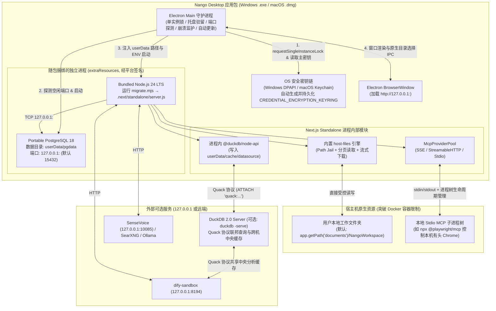

# Nango 桌面应用化总体架构与实施方案 (v2)

> **关联文档**：[`docs/architecture.md`](./architecture.md) · [`docs/docker-deployment.md`](./docker-deployment.md) · [`docs/data-sources.md`](./data-sources.md) · [`docs/host-files.md`](./host-files.md)  
> **状态**：v3 终审版（已整合二轮同行评审与边界核实）  
> **目标平台**：Windows 10/11 (`x64`) · macOS 13+ (`arm64` Apple Silicon / `x64` Intel)

---

## 1. 背景与核心设计决策

Nango 从架构设计之初即定位为**单节点长驻 Node 进程（Single long-running Node process）**——进程内六大缓存、基于 `setTimeout` 的调度器、内存态 SSE 事件总线以及异步 Run 执行树均围绕单进程生命周期构建。这一特性使得 Nango 天然适合封装为**本地桌面应用程序**，同时保持与现有 Docker 部署模式 100% 相同的核心代码基线。

经过架构评审与源码核实，本方案确立以下**六大核心架构决策**：

| 编号 | 架构领域 | 核心决策 | 理由与工程收益 |
| :--- | :--- | :--- | :--- |
| **D1** | **MCP 协议扩展** | 新增 **`stdio` 类型 MCP Server** 一等公民支持（与 `sse`、`http` 并列），默认关闭、仅在 `NANGO_DESKTOP=1`（或显式开启）下启用 | 支持直接拉起 `npx -y @playwright/mcp@latest`（控制本机有头浏览器）、`uvx` 本地工具等主流桌面 MCP 生态，同时不在多租户 Docker 环境增加额外攻击面。 |
| **D2** | **数据源与 DuckDB 2.0** | 基于项目已安装的 `@duckdb/node-api@2.0.0-r.1`，支持 **“In-Process 嵌入式 + DuckDB 2.0 原生 Server Mode (`duckdb -serve` / Quack 协议)” 双模驱动** | 无需自研 HTTP 包装服务：未配置外部地址时走进程内嵌入式模式（开箱即用）；配置 `quack:` 地址后直接利用 DuckDB 2.0 原生 `duckdb -serve` 实现联邦查询计算下推，并解决桌面端与外部/远端 `dify-sandbox` 跨机共享缓存数据集的问题。 |
| **D3** | **本地文件访问** | **保留内置纯 JS `host-files` 引擎**，通过环境变量注入 `app.getPath("documents")` 下的默认工作区并集成原生目录选择器 | 复用已有的行分页保护（防撑爆 LLM 上下文）、读写权限分离、流式下载（`download_file`）及防软链接逃逸（Path Jail），兼容 Windows OneDrive 文档重定向。 |
| **D4** | **主数据库（PG 18）** | **内置便携版 PostgreSQL 18 原生二进制**（支持切换外部 PG URL） | 零代码改动保留 Drizzle Schema、`uuidv7()`、`pg_advisory_lock` 与全部 30+ 历史迁移脚本；由桌面壳自动管理 `initdb`、动态端口与启停。 |
| **D5** | **Node 运行时隔离** | **捆绑独立的官方 Node.js 24 LTS 二进制**运行 `migrate.mjs` 与 `.next/standalone/server.js` | 不混用 Electron 内嵌 Node（避免版本滞后及 N-API ABI 漂移），确保与 `engines: node>=24` 及 `@duckdb/node-api` 预编译二进制 100% 匹配。 |
| **D6** | **外部可选工具服务** | `dify-sandbox`、`sensevoice`、`searxng` 保持外部按需连接；桌面端种子化 URL 自动指向 `127.0.0.1` | 桌面安装包不捆绑重型 Python 沙盒容器或语音模型；同时修复 `seed-infra.ts` 在非 Docker 环境下无法解析容器 DNS 名的问题。 |

---

## 1.1 单主干同源维护策略（Docker 版与桌面版共用一套代码）

**桌面版与 Docker 版 100% 共用同一个 `main` 主干分支与同一套业务代码（`src/`），绝不拉出独立分支维护：**

1. **外围目录物理隔离**：
   - `src/`：Next.js 核心应用、API 路由、Agent 运行时、Drizzle Schema 与迁移脚本，**两端完全共用**。
   - `docker/`：存放容器化构建配置（`Dockerfile`、`start.sh`、`migrate.mjs`）。
   - `desktop/`：存放桌面壳构建配置（Electron 主进程、内置 PG 18 启停管理、托盘、`electron-builder.yml`）。
2. **运行时通过环境变量无感切换**：
   - Docker 容器启动时未设置 `NANGO_DESKTOP`，保持现有全部容器默认行为；
   - 桌面壳启动 `server.js` 时注入 `NANGO_DESKTOP=1` 及用户数据目录环境变量（`NANGO_DEFAULT_HOST_FILE_ROOT`、`NANGO_DEFAULT_CACHE_ROOT`）。
3. **一次提交、双端产物**：
   - 任何新功能或修复合并进 `main` 后，`container.yml` 自动构建多架构 Docker 镜像，`desktop-release.yml` 自动构建 Windows `.exe` 与 macOS `.dmg` 安装包。

---

## 2. 全景架构图



---

## 2.5 DuckDB 2.0 双模架构：内嵌模式 (默认) vs 实验性 Quack Server 模式 (`CONNECT remote_db`)

项目已精确锁定 `@duckdb/node-api@2.0.0-r.1`（`package.json` 已去除 `^` 防止版本漂移）。在 DuckDB 2.0 中，无论是**本地嵌入式计算**，还是通过 **Quack 协议连接远程 DuckDB Server (`duckdb -serve`)**，客户端均统一使用 `@duckdb/node-api`：

### 2.5.1 统一连接工厂与覆盖范围（`src/lib/data-sources/duckdb-connection.server.ts`）

全库涉及 `DuckDBInstance.create(":memory:")` 的共有 3 处，按数据源特性划分为两类路径：
1. **参与双模路由的调用点（2 处）**：
   - [`src/lib/data-sources/duckdb-extension.server.ts`](../src/lib/data-sources/duckdb-extension.server.ts)（Postgres / MySQL / MariaDB 的 `extractViaDuckdb` 与 `testConnectionViaDuckdb`）；
   - [`src/lib/data-sources/runtime-tools.ts`](../src/lib/data-sources/runtime-tools.ts)（`readPreview` 读取 Parquet 前 N 行预览——模式 B 下 Parquet 落在远端 Server，预览查询必须同样经过 `CONNECT remote_db` 路由）。
2. **固定走模式 A（本地进程内）的调用点（1 处）**：
   - [`src/lib/data-sources/vertica/extract.server.ts`](../src/lib/data-sources/vertica/extract.server.ts)：由于 DuckDB 无原生 Vertica 扩展，Vertica 抽取依赖 `vertica-nodejs` 在本地生成临时 NDJSON 后转存 Parquet，因此 **Vertica 始终固定走本地进程内模式（模式 A）**，不参与模式 B 路由。

### 2.5.2 凭据加密存储与防注入校验（遵循 `CredentialTable` 规范）

与 `dify-sandbox` / `sensevoice` 的基础设施凭据管理保持一致，**不将 Quack Token 明文存入 `system_config`**：
- 在 `CredentialTable` 中注册 `provider: "duckdb-server"`（`serviceType: "integration"`），由 AES-256-GCM 加密存储 `{ host: "127.0.0.1:9494", apiKey: "<token>" }`；
- 通过该 Credential 的 `enabled` 开关控制是否启用模式 B（默认不创建或 `enabled: false` 即为模式 A，显式开启即为模式 B **Opt-in 实验特性**）；
- **严格参数白名单校验（防 SQL 注入与日志脱敏）**：
  - `host` 必须通过严格正则 `/^[a-zA-Z0-9.-]+:\d{1,5}$/` 校验（拒绝任何引号、空白符或路径字符）；
  - `token` 必须通过 `/^[a-zA-Z0-9._~+/-]+=*$/` 白名单字符校验；
  - 严禁在任何日志或异常信息中打印含 `TOKEN` 的 `ATTACH` 语句。

```typescript
const HOST_PORT_RE = /^[a-zA-Z0-9.-]+:\d{1,5}$/;
const SAFE_TOKEN_RE = /^[a-zA-Z0-9._~+/-]+=*$/;

export async function openDuckdbConnection(opts?: { forceLocal?: boolean }) {
  const db = await DuckDBInstance.create(":memory:");
  const conn = await db.connect();

  // 注入本地预打包扩展目录（解决离线/内网环境无法访问 extensions.duckdb.org 的问题）
  if (process.env.NANGO_DUCKDB_EXTENSION_DIR) {
    const extDir = process.env.NANGO_DUCKDB_EXTENSION_DIR.replaceAll("'", "''");
    await conn.run(`SET extension_directory = '${extDir}';`);
  }

  if (!opts?.forceLocal) {
    const cred = await getEnabledInfrastructureCredentialByProvider("duckdb-server");
    if (cred?.host) {
      if (!HOST_PORT_RE.test(cred.host)) {
        throw new Error("Invalid duckdb-server host:port format");
      }
      if (cred.apiKey && !SAFE_TOKEN_RE.test(cred.apiKey)) {
        throw new Error("Invalid duckdb-server token characters");
      }
      const tokenClause = cred.apiKey ? ` (TOKEN '${cred.apiKey}')` : "";
      await conn.run(`ATTACH 'quack:${cred.host}' AS remote_db${tokenClause};`);
      await conn.run("CONNECT remote_db;");
    }
  }
  return { db, conn };
}
```

### 2.5.3 离线/内网扩展预置（Bundled DuckDB Extensions）

DuckDB 的 `postgres`、`mysql`、`quack` 扩展默认在首次调用 `INSTALL` 时从 `extensions.duckdb.org` 下载。为确保桌面用户在**无外网或企业内网环境**下开箱可用：
- 在构建期脚本 `desktop/scripts/fetch-binaries.mjs` 中，预先下载对应平台与 DuckDB `v2.0.0` 版本的 `postgres_scanner.duckdb_extension`、`mysql_scanner.duckdb_extension`、`quack.duckdb_extension` 放入 `extraResources/duckdb-extensions/`；
- 桌面主进程启动 `server.js` 时注入 `NANGO_DUCKDB_EXTENSION_DIR=<resourcesPath>/duckdb-extensions`，`openDuckdbConnection()` 自动执行 `SET extension_directory`，彻底消除运行时外网下载依赖。

| 模式 | 触发条件 | 运作机制与适用场景 |
| :--- | :--- | :--- |
| **模式 A：In-Process 嵌入式模式（默认稳定版）** | 未启用 `duckdb-server` 凭据（或数据源为 Vertica） | 在本地进程内 `:memory:` 直接执行抽取，Parquet 落盘至本地 `<userData>/cache/datasource`。适合个人桌面端单机开箱即用。 |
| **模式 B：Quack 远程路由模式（Opt-in 实验特性）** | 在 Admin → Credentials 中配置并启用了 `duckdb-server`（`host:port` + `token`） | 本地 `:memory:` 仅作轻量协议桥，通过 `CONNECT remote_db;` 将 Postgres/MySQL 抽取路由至远程 `duckdb -serve` 执行。**注意**：由于 `COPY ... TO '<outputPath>'` 在远程 DuckDB Server 所在文件系统执行，Nango 与远程 DuckDB Server 必须在相同路径挂载共享缓存目录（`datasource.cache_root`）；抽取完成后 `introspectParquet()` 会通过本地 `fs.stat(outputPath)` 校验文件存在性，若未挂载共享目录则立即显式报错拒绝提交缓存槽。 |

---

## 3. 模块一：支持 `stdio` 类型 MCP Server 详细设计

### 3.1 现状与依赖分析
- 目前 [`McpServerTable`](../src/lib/db/schema.ts) 的 `type` 字段仅支持 `"sse" | "http"`。
- 项目已安装的 `@modelcontextprotocol/client@2.4.0` 原生提供 `@modelcontextprotocol/client/stdio`（导出 `StdioClientTransport`、`getDefaultEnvironment`、`StdioServerParameters`），无需新增 npm 依赖。

### 3.2 安全边界与门禁设计（Security Contract）

1. **环境开关默认关闭（Default-Off in Docker, Default-On in Desktop）**：
   - 新增辅助函数 `isStdioMcpAllowed(): boolean`：
     ```typescript
     export function isStdioMcpAllowed(): boolean {
       if (process.env.NANGO_ALLOW_STDIO_MCP === "true") return true;
       if (process.env.NANGO_ALLOW_STDIO_MCP === "false") return false;
       return process.env.NANGO_DESKTOP === "1";
     }
     ```
   - **理由**：在多租户 Docker 部署中，`runner` 镜像为精简版且不应允许在容器内任意 `spawn` 子进程；而在桌面端（`NANGO_DESKTOP=1`），用户本身即为宿主机所有者，默认开启。
2. **Admin 角色强制校验与字段脱敏**：
   - 即使在允许 `stdio` 的环境中，创建、修改（含启停/可见性切换）、删除 `type === "stdio"` 的 MCP Server，以及对其触发 `discover`、`call-tool`、`tasks` 管理操作，均在路由与 `withMcpAdminClient()` 层强制要求 `session.user.role === "admin"`；
   - `GET /api/mcp-servers` 对非 `admin` 的 `editor` 角色自动脱敏 `stdio` 行的宿主机进程配置字段（`command`、`args`、`env`、`cwd`、`credentialEnvName` 均置为 `null`）。
3. **环境变量白名单隔离（严禁泄漏主进程密钥）**：
   - 构建 `StdioClientTransport` 的 `env` 时，**严禁**传入 `process.env`（防止 `CREDENTIAL_ENCRYPTION_KEYRING`、`BETTER_AUTH_SECRET`、`POSTGRES_PASSWORD` 泄漏给子进程）。
   - 仅以 `getDefaultEnvironment()`（包含 `PATH`, `HOME`, `USERPROFILE`, `APPDATA`, `LOCALAPPDATA`, `SYSTEMROOT`, `PATHEXT`, `TEMP` 等安全系统变量）为基底，再合并用户为该 Server 配置的 `env` 字典。
4. **独立列实现凭证环境变量注入（`credentialEnvName`）**：
   - 不混用 HTTP 专用的 `credentialHeader` 列，而是在 `mcp_server` 表中新增专用列 `credential_env_name: text("credential_env_name")`。
   - 当 `type === "stdio"` 且绑定了 `credentialId` 时，将解密后的凭据值注入子进程的 `env[server.credentialEnvName || "MCP_API_KEY"]`。

### 3.3 数据库 Schema 变更（`src/lib/db/schema.ts`）

对 [`McpServerTable`](../src/lib/db/schema.ts) 新增 5 个字段（通过 `pnpm db:generate --name=mcp_server_stdio_support` 生成迁移）：

```typescript
export const McpServerTable = pgTable("mcp_server", {
  id: uuid("id").primaryKey().notNull().defaultRandom(),
  name: text("name").notNull(),
  description: text("description"),
  /** Transport type: "sse" | "http" | "stdio" */
  type: text("type").notNull(),
  /** Endpoint URL for "sse" | "http". Empty string "" when type === "stdio". */
  url: text("url").notNull().default(""),
  headers: jsonb("headers").$type<Record<string, string>>(),
  credentialId: uuid("credential_id").references(() => CredentialTable.id, {
    onDelete: "cascade",
  }),
  credentialHeader: text("credential_header"),

  // ── Stdio transport fields (used when type === "stdio") ──────────
  /** Executable command, e.g. "npx", "uvx", "node", "python". */
  command: text("command"),
  /** Command arguments array, e.g. ["-y", "@playwright/mcp@latest"]. */
  args: jsonb("args").$type<string[]>(),
  /** Non-sensitive environment variables passed to the child process. */
  env: jsonb("env").$type<Record<string, string>>(),
  /** Optional working directory for the spawned process. */
  cwd: text("cwd"),
  /** Environment variable name into which credentialId token is injected (e.g. "GITHUB_PERSONAL_ACCESS_TOKEN"). */
  credentialEnvName: text("credential_env_name"),
  // ...其余字段保持不变
});
```

### 3.4 Windows 进程树终止（防孤儿进程）与超时控制

> **源码核实发现（QUIRK）**：[`@modelcontextprotocol/client/dist/stdio.mjs`](../node_modules/@modelcontextprotocol/client/dist/stdio.mjs) 内部使用 `cross-spawn` 启动子进程。在 Windows (`win32`) 下运行 `npx` 时，`cross-spawn` 实际启动的顶层进程是 `cmd.exe /d /s /c "npx ..."`。而 SDK 的 `StdioClientTransport.close()` 仅调用了 `processToClose.kill("SIGTERM")`——在 Windows 上这只会终止最外层的 `cmd.exe`，其派生的 `node.exe` 与 `chrome.exe` 会变成孤儿进程一直残留在系统中！

**解决方案（`src/lib/mcp/stdio-spawn.server.ts`）**：
1. **内置 Node.js `PATH` 前置注入（解决目标用户机器未安装 Node/npx 的问题）**：
   - 桌面应用的目标用户（个人或业务人员）电脑上往往没有安装 Node.js 或 `npx`。
   - Electron 主进程启动 `server.js` 时注入 `NANGO_BUNDLED_NODE_BIN_DIR=<resourcesPath>/node/bin`（Windows 下为 `<resourcesPath>/node`）；
   - `stdio-spawn.server.ts` 在组装子进程 `env.PATH`（Windows 下兼容 `Path` 大小写键名）时，自动将 `NANGO_BUNDLED_NODE_BIN_DIR` 前置拼接到 `PATH` 最前面，确保任何 `node` / `npx` 类 `stdio` MCP Server 在纯净裸机上也能直接运行。
2. **包装 `close()` 实现跨平台递归进程树清理与进程退出钩子**：
   - 在 `createStdioTransport()` 返回的 Transport 包装器中记录 `transport.pid`；
   - 当调用 `close()` 时：
     - 在 Windows (`win32`) 上，先执行原生的 `transport.close()`，随后调用 `execFile("taskkill", ["/PID", String(pid), "/T", "/F"])` 递归终止整棵子进程树；
     - 在 macOS / Linux (`darwin` / `linux`) 上，由于 `npx` 会派生多层子进程且默认 `kill("SIGTERM")` 仅作用于父 PID，在调用原生 `transport.close()` 前先通过 `pgrep -P` 自底向上递归收集所有后代 PID 发送 `SIGTERM`，并在 `close()` 完成后发送 `SIGKILL` 兜底清理；
   - 在 [`src/instrumentation.ts`](../src/instrumentation.ts) 的 `SIGTERM` / `SIGINT` / `beforeExit` 退出钩子中统一调用 `mcpProviderPool.shutdown()`，确保服务停止或桌面应用退出时不遗留任何长驻 `stdio` 子进程。
3. **`stderr: "pipe"` 日志采集**：
   - 将子进程的 `stderr` 重定向至 Pino 结构化日志（`component: "mcp-stdio"`），便于观察 `npx` 下载进度或启动报错。
4. **独立的 `stdio` 探测超时配置与前端提示**：
   - 在 [`src/lib/config/defaults.ts`](../src/lib/config/defaults.ts) 中新增配置项：
     ```typescript
     { key: "mcp.stdio_discovery_timeout", value: "120", valueType: "number", description: "Stdio MCP tool discovery timeout in seconds (allows first-run npx/uvx package downloads)" }
     ```
   - 在 `/api/mcp-servers/[id]/discover` 与 `client-providers.ts` 中，当 `type === "stdio"` 时采用 `mcp.stdio_discovery_timeout`（默认 120 秒，而非 HTTP/SSE 的 5 秒）；
   - 前端 `McpPanel` 在对 `stdio` Server 执行 Discover 时展示提示文案：*“正在启动本地进程（首次运行 npx/uvx 可能需要下载依赖包，耗时约 10–60 秒）…”*。

---

## 4. 模块二：运行时路径收口与桌面环境种子适配

### 4.1 解决 macOS `.app` Bundle / Windows `Program Files` 只读问题

在桌面打包后，应用安装目录（如 `/Applications/Nango.app/Contents/Resources`）是**只读**的。任何写入 `process.cwd()` 的操作都会直接抛出 `EROFS` / `EACCES`。

因此，所有运行时可写目录必须全部收敛至 Electron 的 `app.getPath("userData")`（Windows 下为 `%APPDATA%\Nango`，macOS 下为 `~/Library/Application Support/Nango`）：

| 目录用途 | 环境变量覆盖键 | 桌面端实际路径與多模式语义说明 |
| :--- | :--- | :--- |
| **PostgreSQL 数据目录** | `NANGO_PGDATA_DIR` | `<userData>/pgdata` |
| **数据源 Parquet 缓存** | `NANGO_DEFAULT_CACHE_ROOT` | 模式 A（默认本地）为 `<userData>/cache/datasource`；若启用模式 B（远程 Quack Server），`COPY ... TO` 路径作用于远端 DuckDB Server 所在文件系统（需在 Admin → Config 中按远端路径设置 `datasource.cache_root`）。 |
| **Playwright 存储状态** | `NANGO_PLAYWRIGHT_STORAGE_DIR` | `<userData>/cache/playwright` |
| **本地文件工具默认根目录** | `NANGO_DEFAULT_HOST_FILE_ROOT` | `<app.getPath("documents")>/NangoWorkspace`（仅首次启动 `insert-if-absent` 写入 `system_config`；若用户日后修改 OneDrive 设置或迁移机器，可通过 §5.3 的 Admin → Config 原生文件夹选择器一键更新）。 |

**代码改动点（仅需改动 3 处，且不绕过内存配置缓存）**：
1. [`src/lib/config/defaults.ts`](../src/lib/config/defaults.ts)：
   - `host.file.root` 的初始默认值改为：`process.env.NANGO_DEFAULT_HOST_FILE_ROOT || "/shared_folder"`；
   - `datasource.cache_root` 的初始默认值改为：`process.env.NANGO_DEFAULT_CACHE_ROOT || ""`。
   - **关键优势**：在 [`src/instrumentation.ts`](../src/instrumentation.ts) 启动时，`seedDefaults()` 会直接把环境变量提供的桌面路径作为初始值写入 `system_config` 表，紧接着由 `loadAllConfigs()` 读入进程内缓存——**无需桌面壳直接操作数据库，也无需等待服务启动后再调 API 修改**。
2. [`src/lib/data-sources/cache-root.ts`](../src/lib/data-sources/cache-root.ts)：
   ```typescript
   export function resolveCacheRoot(): string {
     const fromConfig = getConfig("datasource.cache_root", "");
     if (fromConfig.length > 0) return path.resolve(fromConfig);
     if (process.env.NANGO_DEFAULT_CACHE_ROOT) {
       return path.resolve(process.env.NANGO_DEFAULT_CACHE_ROOT);
     }
     return path.join(process.cwd(), ".cache", "datasource");
   }
   ```
3. [`src/lib/playwright/storage.server.ts`](../src/lib/playwright/storage.server.ts)：同样优先读取 `process.env.NANGO_PLAYWRIGHT_STORAGE_DIR` 或 `<userData>/cache/playwright`。

### 4.2 修复 [`src/lib/credentials/seed-infra.ts`](../src/lib/credentials/seed-infra.ts) 的 Docker DNS 硬编码与零依赖 Playwright 种子

目前 `seed-infra.ts` 硬编码了容器主机名 `http://sandbox:8194`、`http://sensevoice:8000` 和 `http://playwright:8931/mcp`。在桌面端（`process.env.NANGO_DESKTOP === "1"`）下自动切换为宿主机回环地址与**内置零外部依赖的 `stdio` Playwright**：

- **Dify Sandbox**：默认 `host` / `restUrl` 设为 `process.env.NANGO_SEED_SANDBOX_URL ?? (isDesktop ? "http://127.0.0.1:8194" : "http://sandbox:8194")`。
- **SenseVoice**：默认 `host` / `restUrl` 设为 `process.env.NANGO_SEED_SENSEVOICE_URL ?? (isDesktop ? "http://127.0.0.1:10085" : "http://sensevoice:8000")`。
- **Playwright MCP Server（复用捆绑 Node/npx 与本机浏览器）**：
  - Docker 模式：保持 `type: "http", url: "http://playwright:8931/mcp"`；
  - 桌面模式（`isDesktop`）：
    - 无需在安装包中预装 `@playwright/mcp`：由于 `stdio-spawn.server.ts` 已将随包捆绑的 Node 24 LTS 目录（`NANGO_BUNDLED_NODE_BIN_DIR`，内含 `node` 与 `npx`）前置注入子进程 `PATH`，即使目标用户电脑未安装 Node.js，也能直接通过捆绑的 `npx` 按需拉起：`type: "stdio", command: "npx", args: ["-y", "@playwright/mcp@latest", "--browser", "chrome"]`；
    - **浏览器策略**：默认使用 `--browser chrome`（Windows 下若未装 Chrome 可在 MCP 参数中改为 `msedge`），直接驱动用户本机已安装的 Chrome/Edge 有头浏览器，免去下载 300MB Chromium。

---

## 5. 模块三：本地文件引擎（`host-files`）桌面端增强

1. **保留内置实现**：完整保留 [`src/lib/host-files/`](../src/lib/host-files/) 下的 Path Jail、按行/字节流式分页读取与大文件流式下载能力。
2. **使用 `app.getPath("documents")` 规避 OneDrive 重定向坑**：
   - 在 Windows 上，若用户开启了 OneDrive 备份，文档目录实际位于 `C:\Users\<user>\OneDrive\Documents`，硬编码 `os.homedir() + "/Documents"` 会找错目录。
   - Electron 主进程在启动 `server.js` 前，调用 `path.join(app.getPath("documents"), "NangoWorkspace")`，递归 `mkdirSync` 创建该文件夹，并通过 `NANGO_DEFAULT_HOST_FILE_ROOT` 注入。
3. **原生目录选择框（Folder Picker IPC）**：
   - Electron `preload.ts` 通过 `contextBridge.exposeInMainWorld("nangoDesktop", { selectFolder: () => ipcRenderer.invoke("dialog:selectFolder") })` 暴露安全接口；
   - 在 Admin → Config 页面渲染 `host.file.root` 配置项时，若检测到 `window.nangoDesktop?.selectFolder`，在输入框旁显示 **“选择本地文件夹…”** 按钮，点击后弹出系统原生目录选择器并直接通过 Config API 保存（自动触发服务端内存缓存更新）。

---

## 6. 模块四：桌面外壳与发布工程设计（Production Engineering）

### 6.1 目录结构与捆绑资源布局

```text
nango/
├── desktop/
│   ├── main.ts                 # Electron 主进程：单实例锁、端口分配、生命周期编排
│   ├── preload.ts              # contextBridge 安全暴露桌面端 IPC 接口
│   ├── keyring.ts              # 基于 Electron safeStorage (DPAPI/Keychain) 生成/读取加密主密钥
│   ├── port-finder.ts          # 探测空闲端口 (优先 PG:15432, App:9300，冲突自动顺延)
│   ├── postgres-manager.ts     # 便携版 PG18 initdb / PG_VERSION 校验 / 启停与崩溃重启
│   ├── server-manager.ts       # 使用捆绑的 Node 24 执行 migrate.mjs 并守护 server.js
│   ├── tray.ts                 # 系统托盘驻留与菜单
│   ├── updater.ts              # electron-updater 自动更新检查
│   ├── electron-builder.yml    # 打包配置 + extraResources + macOS notarize 钩子
│   └── scripts/
│       ├── fetch-binaries.mjs  # 按目标平台下载 Node 24 LTS + Portable PG 18 二进制
│       └── after-sign.mjs      # macOS 深度签名 (Deep Codesign) 与公证脚本
├── scripts/
│   └── repair-standalone.mjs   # 跨平台 Node 版 .next/standalone/.pnpm 符号链接闭包修复脚本
```

### 6.2 进程健壮性与边界情况处理

1. **单实例锁（Single Instance Lock）**：
   - 启动时第一时间调用 `app.requestSingleInstanceLock()`。若返回 `false`，立即退出当前进程，并通过 `second-instance` 事件将已运行的 Nango 窗口置顶唤醒，**严防两个桌面实例同时启动抢占同一个 `pgdata` 目录导致数据库锁冲突**。
2. **动态端口探测与 `BETTER_AUTH_URL` 联动**：
   - **PostgreSQL 端口**：从 `15432` 起探测空闲端口 `pgPort`，写入 `POSTGRES_PORT`。若上次异常断电残留了陈旧的 `postmaster.pid` 且对应 PID 已不存在，`postgres-manager.ts` 自动清理陈旧锁文件后再启动。
   - **Next.js 服务端口**：从 `9300` 起探测空闲端口 `appPort`，同时注入 `PORT=${appPort}` 与 `BETTER_AUTH_URL=http://127.0.0.1:${appPort}`（确保 `better-auth` 的 Cookie 与 Origin 校验不会因为端口顺延而失败）。
3. **子进程崩溃监护与退避重启（Crash Supervisor）**：
   - 当主进程未处于 `isQuitting` 状态而 `server.js` 或 `postgres` 意外退出时，通过指数退避（1s → 2s → 4s，最多连续 3 次）自动拉起恢复；若连续 3 次失败则弹出原生错误对话框并提供“打开日志目录”按钮。
4. **PostgreSQL 数据目录版本管理**：
   - 首版固定搭载 PostgreSQL 18。`postgres-manager.ts` 在启动前读取 `<userData>/pgdata/PG_VERSION`（应为 `18`），为未来大版本升级预留 `pg_upgrade` 检测钩子。
5. **优雅退出序列（Graceful Shutdown）**：
   - 用户点击托盘“退出” →向 `server.js` 发送信号（触发 `mcpProviderPool.shutdown()` 清理所有 `stdio` 子进程树）→ 等待 `server.js` 退出（超时 5s 强杀）→ 执行 `pg_ctl stop -D <pgdata> -m fast` 等待数据落盘 → 退出 Electron。

### 6.3 macOS 代码签名与公证（Code Signing & Notarization — 发版阻断级）

macOS Gatekeeper 会扫描 `.app` Bundle 内的**所有** Mach-O 可执行文件与动态库（包括 `extraResources` 中的二进制）。任何未签名或未开启 Hardened Runtime 的第三方二进制都会导致整个 App 在用户电脑上无法启动。

必须在 `desktop/scripts/after-sign.mjs`（挂载到 `electron-builder` 的 `afterPack` / `afterSign` 钩子）中，按**由内向外（Inside-Out）**顺序使用 `Developer ID Application` 证书（带 `--force --options runtime --timestamp` 及允许 JIT/Unsigned Executable Memory 的 `entitlements.mac.plist`）对以下全部二进制逐个签名，最后提交 ` @electron/notarize` 公证：

1. **捆绑的 PostgreSQL 18 二进制**：`pg/lib/*.dylib` → `pg/lib/postgresql/*.so` → `pg/bin/postgres`, `pg/bin/initdb`, `pg/bin/pg_ctl`, `pg/bin/pg_isready`。
2. **捆绑的官方 Node 24 LTS 二进制**：`node/bin/node`（需附加 `com.apple.security.cs.allow-jit` 权限以支持 V8 JIT 与 WASM）。
3. **Next.js Standalone 内的原生动态库**：
   - `@duckdb/node-api-darwin-*` 下的 `duckdb.node` 与 `libduckdb.dylib`；
   - `esbuild`（若存在开发构建残留则剔除）。
4. **主应用包签名与公证**：完成内部二进制签名后，重签顶层 `Nango.app`，打包 `.dmg` 并执行 `notarize` + `xcrun stapler staple`。

---

## 7. 分阶段实施路线图（Implementation Roadmap）

采纳评审建议，将**最高技术风险项（便携 PG 18 + 独立 Node 24 + DuckDB 预编译包在桌面端的打包与签名探针）**提前至 Phase 1 并行验证：

### Phase 1：`stdio` MCP Server 支持 + 桌面二进制可行性探针（Spike）
- [ ] **Step 1.1（DB 迁移）**：修改 [`src/lib/db/schema.ts`](../src/lib/db/schema.ts) 的 `McpServerTable`，新增 `command`、`args`、`env`、`cwd`、`credentialEnvName` 五列，生成并提交 Drizzle 迁移。
- [ ] **Step 1.2（Stdio 传输层与进程树清理）**：实现 `src/lib/mcp/stdio-spawn.server.ts`（含 `isStdioMcpAllowed()` 默认关闭门禁、`getDefaultEnvironment()` 隔离、`credentialEnvName` 注入、Windows `taskkill /T /F` 进程树递归终止、`stderr` 日志转发）。
- [ ] **Step 1.3（连接池与发现超时）**：扩展 `client-providers.ts`、`provider-pool.ts`、`index.ts`、`admin-client.server.ts` 支持 `"stdio"`；在 `defaults.ts` 新增 `mcp.stdio_discovery_timeout = 120`。
- [ ] **Step 1.4（API 与前端表单）**：更新 `/api/mcp-servers` 路由（`stdio` 要求 Admin 角色 + 环境门禁）及 `McpPanel.tsx` UI（支持配置 `command` / `args` / `env` / `cwd` / `credentialEnvName` 及首次探测长耗时提示）。
- [ ] **Step 1.5（并行 Spike）**：验证独立 Node 24 二进制 + 便携版 PG 18 + `@duckdb/node-api` 在本地脱离 Docker 启动 `.next/standalone/server.js` 的完整闭环。

### Phase 2：桌面运行时路径收口、种子配置适配与跨平台 Standalone 修复脚本
- [ ] **Step 2.1（路径与配置种子）**：改造 `defaults.ts`、`cache-root.ts`、`playwright/storage.server.ts`，支持 `NANGO_DEFAULT_HOST_FILE_ROOT`、`NANGO_DEFAULT_CACHE_ROOT`、`NANGO_PLAYWRIGHT_STORAGE_DIR` 环境变量注入，彻底消除对只读 `process.cwd()` 的写入假设。
- [ ] **Step 2.2（基础设施种子适配）**：改造 `seed-infra.ts`，在 `NANGO_DESKTOP=1` 下将默认 Sandbox / SenseVoice URL 设为 `127.0.0.1` 端口，并将默认 Playwright MCP Server 种子化为本地 `stdio` 模式（`npx -y @playwright/mcp@latest`）。
- [ ] **Step 2.3（跨平台 Standalone 闭包修复）**：编写 `scripts/repair-standalone.mjs`（用 Node `fs` 替代 Dockerfile 中的 Linux shell 脚本），确保在 Windows 和 macOS 上构建 `NEXT_STANDALONE_OUTPUT=true pnpm build` 后能完整保留 `@duckdb/node-api` 的 `libduckdb` 动态库与 `serverExternalPackages` 依赖闭包。
- [ ] **Step 2.4（原生目录选择预留）**：优化 `jail.server.ts` 桌面端报错文案，并在 Admin → Config 的 `host.file.root` 旁支持调用 `window.nangoDesktop?.selectFolder()`。

### Phase 3：Electron 桌面守护工程搭建（`desktop/`）
- [ ] **Step 3.1（核心守护模块）**：实现 `desktop/main.ts`（含 `requestSingleInstanceLock`）、`keyring.ts`（`safeStorage` 密钥管理）、`port-finder.ts`（动态端口探测与 `BETTER_AUTH_URL` 联动）。
- [ ] **Step 3.2（PG 18 与 Server 管理器）**：实现 `postgres-manager.ts`（`initdb`、`PG_VERSION` 校验、陈旧 `postmaster.pid` 清理、优雅停止）与 `server-manager.ts`（执行 `migrate.mjs`、拉起 `server.js`、崩溃指数退避重启）。
- [ ] **Step 3.3（托盘与原生交互）**：实现 `tray.ts`（关闭窗口最小化到托盘，保障后台 `schedule` 定时任务运行）与 `preload.ts`（文件夹选择 IPC）。

### Phase 4：多平台打包、macOS 签名公证与自动更新流水线
- [ ] **Step 4.1（二进制拉取与打包配置）**：编写 `desktop/scripts/fetch-binaries.mjs`（按目标架构拉取官方 Node 24 LTS、精简版 PG 18 二进制以及预置 DuckDB 离线扩展包 `postgres`/`mysql`/`quack`）及 `electron-builder.yml`（支持 `win-x64` NSIS 安装包、`mac-arm64` / `mac-x64` DMG）。
- [ ] **Step 4.2（macOS 深度签名与公证）**：实现 `desktop/scripts/after-sign.mjs` 与 `entitlements.mac.plist`，覆盖 PG 18、Node 24、`duckdb.node` / `libduckdb.dylib` 及 `.duckdb_extension` 的 Inside-Out 签名与 Apple Notarization 验收。
- [ ] **Step 4.3（自动更新、桌面端冒烟 E2E 与 CI 发布）**：集成 `electron-updater`，编写基于 Playwright `_electron.launch()` 的桌面端启动冒烟测试（验证内置 PG 初始化 → 迁移 → Next.js 就绪 → 主窗口渲染闭环），并新增 `.github/workflows/desktop-release.yml` 自动化构建流水线。
